# Workout Analysis Report: W06 Tuesday GA Run + 6 Strides (11.11 km)

- **Date**: Tuesday, October 6, 2026
- **Activity File**: `2026-10-06-i194284015_intervals.csv`
- **Report File**: `2026-10-06-i194284015_intervals.md`
- **Athlete Profile**: Rest HR 42 bpm | Max HR 190 bpm | HRR 148 bpm | Target Marathon: 3:29:34 (4:58/km)
- **Target Prescription**: Pfitzinger W06 Tuesday: **11.0 km General Aerobic @ 5:30 min/km + 6 Strides**
- **Actual Execution**: **11.11 km @ 5:33 min/km w/ 6 text-book strides (Avg HR: 146.6 bpm)**

---

## 📊 Executive Performance Dashboard

| Metric | Recorded Value | Target / Prescribed | Coaching Evaluation |
| :--- | :--- | :--- | :--- |
| **Total Distance** | **11.09 km (11.11 km GPS)** | 11.0 km | 🌟 **Spot-on volume to the exact tenth!** |
| **Moving Time** | **1 hr 01 min 29 sec (61:29)**| ~60–62 min | 🟢 **Perfect time-on-feet duration** |
| **Elapsed Time** | 1 hr 03 min 22 sec (Pause: 1:53) | — | 🟢 Minimal stoppage outside of walk recoveries |
| **Average Moving Pace** | **5:33 min/km (8:56/mi)** | 5:30 min/km | 🟢 **Smooth, controlled aerobic pace** |
| **Grade Adjusted Pace (GAP)**| **5:37 min/km** | 5:30 min/km | 🟢 **Uniform effort over +61m climbing** |
| **Average Heart Rate** | **146.6 bpm (77.2% Max / 70.7% HRR)** | 135 – 150 bpm (GA Zone) | 🟢 **Textbook General Aerobic heart rate** |
| **Peak Heart Rate** | **166 bpm** | < 170 bpm | 🟢 **Zero anaerobic or threshold strain** |
| **Average Cadence** | **175.1 spm** | 175 – 180 spm | 🌟 **Consistent, joint-protecting turnover** |
| **Average Power** | **338.2 W** (Peak 490W) | 330 – 355 W | 🟢 **Steady aerobic engine** |
| **Ground Contact Balance** | **50.4% Left / 49.6% Right** | 50.0 / 50.0 | 🌟 **Near-perfect bilateral symmetry** |
| **Vertical Ratio** | **8.82%** | < 9.0% | 🌟 **Elite horizontal forward drive!** |

---

## ⚡ The 6 Strides: Execution Deep Dive

Your execution of the 6 strides was **textbook**:

```mermaid
graph LR
    S1["Stride 1: 112m @ 4:45<br/>Pwr: 387W / VR: 7.9%"] --> W1["Walk 1: 48s<br/>HR -> 153 bpm"]
    W1 --> S2["Stride 2: 103m @ 4:11<br/>Pwr: 475W / VR: 7.2%"]
    S2 --> W2["Walk 2: 48s<br/>HR -> 145 bpm"]
    W2 --> S3["Stride 3: 111m @ 3:53<br/>Pwr: 490W / VR: 7.5%"]
    S3 --> W3["Walk 3: 50s<br/>HR -> 145 bpm"]
    W3 --> S4["Stride 4: 105m @ 4:05<br/>Pwr: 460W / VR: 7.3%"]
    S4 --> W4["Walk 4: 50s<br/>HR -> 141 bpm"]
    W4 --> S5["Stride 5: 102m @ 4:14<br/>Pwr: 464W / VR: 7.4%"]
    S5 --> W5["Walk 5: 52s<br/>HR -> 141 bpm"]
    W5 --> S6["Stride 6: 102m @ 4:03<br/>Pwr: 477W / VR: 7.2%"]
    S6 --> W6["Walk 6: 37s<br/>HR -> 144 bpm"]
    W6 --> Post["Post-Strides Cruise<br/>3.43 km @ 5:24"]
```



### Strides & Recovery Metrics Breakdown

| Rep | Distance | Duration | Average Pace | Peak Power | Stride Length | Vertical Ratio | Walk Recovery | HR Reset To |
| :---: | :---: | :---: | :---: | :---: | :---: | :---: | :---: | :---: |
| **#1** | 112 m | 31.9 s | 4:45 /km | 387 W | 1.20 m | 7.9% | 72 m in 48 s | 153 bpm |
| **#2** | 103 m | 25.9 s | 4:11 /km | 475 W | 1.26 m | **7.2%** | 59 m in 48 s | 145 bpm |
| **#3** | 111 m | 25.9 s | **3:53 /km** | **490 W** | **1.34 m** | 7.5% | 76 m in 50 s | 145 bpm |
| **#4** | 105 m | 25.7 s | **4:05 /km** | 460 W | 1.27 m | **7.3%** | 70 m in 50 s | 141 bpm |
| **#5** | 102 m | 25.9 s | 4:14 /km | 464 W | 1.22 m | 7.4% | 72 m in 52 s | 141 bpm |
| **#6** | 102 m | 24.8 s | **4:03 /km** | 477 W | 1.26 m | **7.2%** | 49 m in 37 s | 144 bpm |

### Coaching Praise on Stride Discipline:
1. **Pacing Target Met**: Across reps #2 through #6, you locked directly into **3:53 to 4:14 min/km**, perfectly matching the 3:45–4:15 mile-pace neuromuscular window.
2. **Rep Length & Duration**: Every rep measured between **102m and 112m (24.8s to 25.9s)**. Highly disciplined pacing control.
3. **World-Class Mechanical Efficiency (VR: 7.2% – 7.5%)**: During top speed, your Vertical Ratio compressed to an astonishing **7.2% – 7.5%**. This proves you are driving purely horizontal forward propulsion with almost zero vertical bounce penalty.
4. **Walk Recoveries (~48s)**: You walked for an average of 48 seconds between reps, allowing your nervous system to reset without accumulating lactic acid.

---

## 🏃 3-Phase Workout Progression

### 1. Phase 1: Aerobic Base Run (0.0 km to 6.63 km)
- **Pace**: **5:22 min/km** | **Avg HR**: **143 bpm** (Max 161 bpm) | **Power**: 350 W | **Cadence**: 176.5 spm
- Solid aerobic opening. You locked into a crisp 5:22 pace while keeping average heart rate strictly in the low-140s.

### 2. Phase 2: The Neuromuscular Strides Block (6.63 km to 7.68 km / ~1.05 km)
- Executed the 6 strides and walking resets as detailed above.

### 3. Phase 3: Post-Strides Aerobic Extension (7.68 km to 11.11 km / 3.43 km)
- **Pace**: **5:24 min/km** | **Avg HR**: **154 bpm** (Max 166 bpm) | **Power**: 354 W | **Cadence**: 176.0 spm
- You didn't just stop after the strides—you resumed running for an extra 3.4 km at **5:24 min/km**, bringing the total volume to **11.11 km**. 
- Heart rate was slightly elevated (154 bpm vs 143 bpm in Phase 1) due to cardiac output from the fast strides, but remained safely in the aerobic zone.

---

## 💓 Heart Rate Zone Compliance Breakdown

```text
[Recovery (<142 bpm)]       ██ (4.1% - 2.5 min)
[General Aerobic (142-152)] ████████████████ (63.6% - 39.1 min)
[Marathon Pace (153-165)]   ████████ (32.3% - 19.8 min - strides & Phase 3)
[Lactate Threshold (>165)]  (0.0% - 0.0 min)
```

- **67.7% of the run** was spent in Recovery and General Aerobic territory (< 152 bpm).
- The time in the Marathon Pace zone (153–165 bpm) was driven by the neuromuscular power spikes during the strides and the final 3.4 km cruise.
- Zero threshold or anaerobic debt was accumulated.

---

## 📅 Roadmap for the Rest of Week 6 (Sep 28 – Oct 11)

Following your huge **19.34 km long run last Saturday**, here is how to structure the remainder of Week 6:

1. **Wednesday, Oct 07 (Tomorrow)**:
   - **Midweek Medium-Long Run (MLR)**: **13.0 – 14.5 km @ 5:25 – 5:30 min/km**.
   - Keep the opening 3 km gentle (~5:40/km) to let your legs settle in before locking into 5:25 pace.
2. **Thursday, Oct 08**:
   - **Full Rest Day** (or optional climbing session).
3. **Friday, Oct 09**:
   - **Recovery Run**: **6.5 – 8.0 km @ 5:50 – 6:05 min/km (< 142 bpm)**.
4. **Saturday, Oct 10**:
   - **The Rebalanced Long Run**: **14.0 – 16.0 km @ 5:30 min/km**.
   - *(Remember our Week 5/6 swap: because you already conquered 19.34 km on Saturday, capping this weekend's long run at 14–16 km provides a smart, healthy volume consolidation before stepping up to 21 km in Week 7!)*
5. **Sunday, Oct 11**:
   - **General Aerobic / Easy Recovery**: **8.0 – 9.5 km @ 5:35 min/km**.
